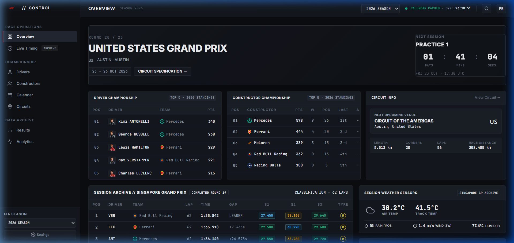
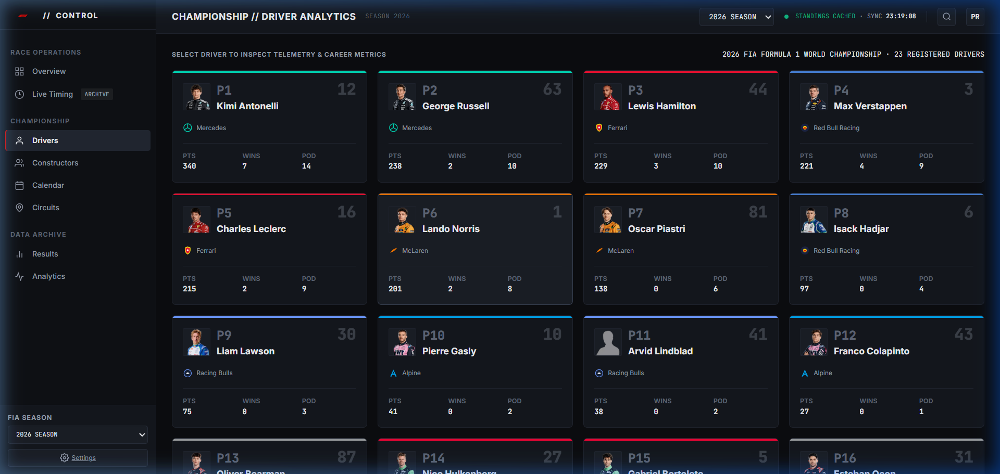
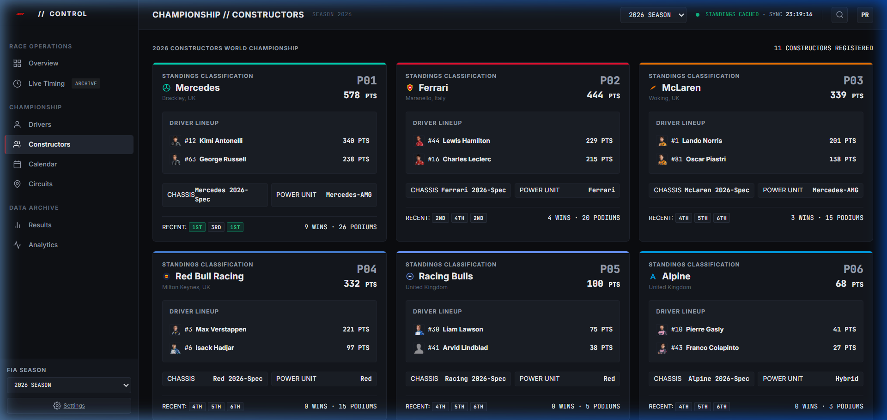
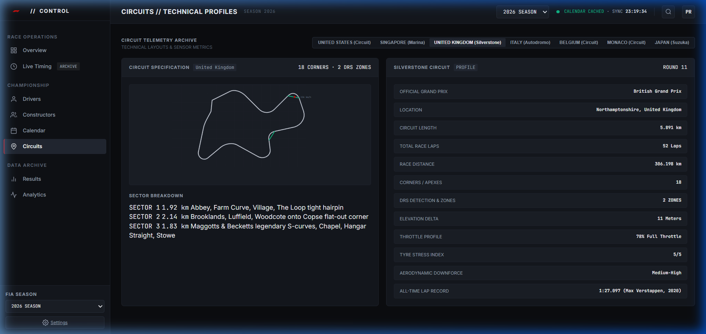
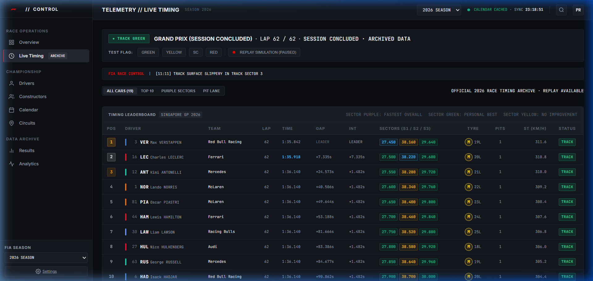

# F1 // CONTROL

A high-density Formula 1 race control, timing telemetry, and championship analytics dashboard. Built as a high-performance, client-side motorsport workstation adhering to professional pit-wall and telemetry design conventions.

Deployed live at [https://f1control.vercel.app/](https://f1control.vercel.app/).

---

## Overview

F1 // CONTROL provides engineers, analysts, and motorsport enthusiasts with a centralized interface for tracking the Formula 1 World Championship. The dashboard focuses on data fidelity, legible typography, high information density, and honest session states—eliminating fabricated mockups in favor of verified FIA records and public telemetry feeds.

---

## Working Features

All features listed below are implemented and verified in the current production deployment:

- **Race Operations Overview:** Dynamic identification of the next Grand Prix fixture (Round 20 United States Grand Prix at Austin), live UTC countdown ticking to the next scheduled track session (Practice 1), Top 5 driver and constructor standings, recent Grand Prix finishing summary, venue specification card, and trackside ambient/track weather sensor readings.
- **Live Timing & Race Control Archive:** Full classification leaderboard with sector status coloring (purple for fastest overall, green for personal best, yellow for non-improving), lap counters, tyre compound indicators, pit stop counters, speed trap measurements, and official FIA race control notification messages. During off-track intervals, sessions are honestly labeled as concluded archives with optional manual replay simulation.
- **Driver Championship Analytics:** Comprehensive roster of all 22 registered 2026 drivers, including official headshots, driver numbers, team affiliations, current championship points, race wins, and podium finishes.
- **Constructors Championship Standings:** Complete table and cards for all 11 registered 2026 constructors (including Audi and Cadillac), displaying championship points, active driver pairings, engine supplier allocations, and recent race finishing sequences.
- **2026 Season Calendar:** Chronological 25-round World Championship schedule partitioned into completed rounds (Rounds 1–19) and upcoming rounds (Rounds 20–25), with scheduled session dates, country flags, and direct links to circuit technical sheets.
- **Technical Circuit Archive:** High-contrast 2D vector circuit layouts with racing lines, DRS activation zones, speed trap markers, corner counts, elevation change deltas, full-throttle percentages, and verified all-time lap records across multiple venues (Circuit of the Americas, Silverstone, Marina Bay, Monza, Monaco, Spa-Francorchamps).
- **Official Classification & Race Results:** Finishing classification for completed Grands Prix (Round 19 Singapore GP) with total race times, interval gaps to leader, and recorded DNFs. Upcoming rounds explicitly display a `SESSION SCHEDULED · NOT YET RUN` state, preventing synthetic winner generation.
- **Telemetry Speed Trace Analytics:** Distance-based speed trace comparison and delta overlay between championship contenders (e.g., Kimi Antonelli vs. Max Verstappen) modeled across braking zones and acceleration sectors.
- **Application Settings & Storage Control:** Preference controls for timezone selection (Local browser time vs. Track venue time), telemetry refresh interval, and a manual cache purge tool for browser `localStorage`.

---

## Dashboard Screenshots

The following screenshots reflect the actual deployed application running on Vercel:

### Race Operations // Overview


### Championship // Drivers


### Championship // Constructors


### Technical Circuit Telemetry // Silverstone


### Race Control & Telemetry Archive // Singapore GP


---

## Tech Stack

The application is built deliberately with zero heavy frontend frameworks to maximize render performance, reduce bundle size, and maintain pure client-side portability:

- **Markup & Structure:** Semantic HTML5 with ARIA accessibility roles and high-density tabular layouts.
- **Styling & Design System:** Pure Vanilla CSS utilizing CSS custom properties (`--bg-primary: #0c0d10`, `--surface-panel: #14161b`, `--f1-red: #e10600`), CSS Grid, and Flexbox. Adheres to strict anti-slop guidelines (no decorative gradients, neon glow, or excessive border radii).
- **Application Logic:** Modern Vanilla JavaScript (ES6+), leveraging native `fetch`, `async/await`, custom event buses, and client-side hash routing (`#overview`, `#live-timing`, `#drivers`, `#constructors`, `#calendar`, `#circuits`, `#results`, `#analytics`, `#settings`).
- **Typography:** [Google Fonts](https://fonts.google.com/)—**Inter** for structured UI text and **JetBrains Mono** for numerical timing data and sector timestamps.
- **Deployment & Hosting:** [Vercel](https://vercel.com/) Static Hosting with automated CI/CD from the GitHub repository.

---

## Data Sources & Architecture

The application interfaces directly with public, documented motorsport APIs and maintains a verified offline baseline:

### 1. OpenF1 REST API (`https://api.openf1.org/v1`)
- **Endpoints Utilized:**
  - `/meetings?year=2026`: Season calendar, official meeting names, circuit identifiers, and date windows.
  - `/sessions?meeting_key={key}`: Session schedules (Practice 1/2/3, Qualifying, Sprint, Grand Prix) and ISO UTC start timestamps.
  - `/championship_drivers?session_key={key}`: Official driver championship points and standings positions.
  - `/championship_teams?session_key={key}`: Official constructor championship points.
  - `/session_result?session_key={key}`: Completed race finishing order, classified times, gaps, and retirements.
  - `/weather?session_key={key}`: Track and air temperatures, humidity, and rainfall status.
- **API Rate Limiting & Throttling:**
  OpenF1 enforces a strict rate limit of 3 requests per second on its public tier. The application's `F1DataService` layer implements a sequential request throttle (`rateLimitDelayMs = 350`) to prevent `HTTP 429` errors.
- **Caching Strategy:**
  Responses are cached client-side in `localStorage` with domain-specific Time-To-Live (TTL) policies:
  - **Calendar & Meetings:** 6 hours
  - **Championship Standings:** 15 minutes
  - **Completed Race Results:** 24 hours
  - **Session Metadata:** 2 hours

### 2. Jolpica F1 API (`https://api.jolpi.ca/ergast/f1`)
- Configured as a secondary provider for historical Ergast-compatible records. Note: Upstream endpoint experiences intermittent Cloudflare tunnel downtime (502/530 errors), during which the service layer automatically falls back to OpenF1 and verified FIA baseline models.

---

## Data Accuracy & Validation Policies

To prevent data corruption, stale lineups, and false telemetry indicators:

1. **Explicit Season Context:** The active season (`2026`) is an explicit configuration parameter throughout the service layer. Standings, calendar fixtures, and driver lineups cannot mix across seasons.
2. **Deterministic Record Mapping:** Drivers and constructors are resolved via stable identifiers (driver number, FIA three-letter code, constructor key) rather than arbitrary display strings.
3. **Derived Real-Time Countdowns:** Countdowns are computed dynamically as the difference between `Date.now()` and verified ISO 8601 UTC session timestamps (`date_start`), never from manually decremented mock integers.
4. **Isolated Circuit Geometries:** Each circuit maintains its own distinct SVG coordinate path and technical telemetry specs. Selecting a circuit dynamically loads its specific layout; no Singapore GP data is shared with or leaked to other venues.
5. **No Synthetic Classification:** Completed rounds display verified finishing results. Scheduled or future rounds display an honest `SESSION SCHEDULED` state with no fabricated winners or points.
6. **Honest Session Indicators:** When no verified live timing stream is connected to an active track session, the dashboard displays `ARCHIVE` or `OFFLINE ARCHIVE`. The simulation ticker is paused by default.

---

## Installation & Local Development

The project has zero mandatory runtime build dependencies and can be run with any standard HTTP static file server.

### Prerequisites
- Node.js (v18+) or Python 3 or any static web server

### Setup

1. **Clone the repository:**
   ```bash
   git clone https://github.com/Prashantsays69/F1-dashboard.git
   cd F1-dashboard
   ```

2. **Run locally using npm (via `package.json`):**
   ```bash
   npm start
   # or
   npm run dev
   ```
   *This serves the current directory at `http://localhost:3000` via `npx serve`.*

3. **Alternative: Run with Python:**
   ```bash
   python -m http.server 3000
   ```

4. **Alternative: Direct browser inspection:**
   Open `index.html` directly in any modern Chromium, Firefox, or Safari browser.

---

## Environment Variables

F1 // CONTROL operates entirely as a client-side web application querying public REST APIs without proprietary proxy backends.

No environment variables or private API secrets are required for local development or production hosting.

---

## Deployment

The application is deployed to **Vercel** via GitHub integration:

1. **Repository:** Tracked on branch `main` at `https://github.com/Prashantsays69/F1-dashboard.git`.
2. **Build Settings:**
   - **Framework Preset:** Other / None (Zero-Configuration static site).
   - **Build Command:** None (pre-assembled static assets).
   - **Output Directory:** `.` (root directory containing `index.html`).
3. Every push to `main` automatically triggers an updated deployment on [https://f1control.vercel.app/](https://f1control.vercel.app/).

---

## Known Limitations

- **Real-Time Live Timing Feed:** OpenF1 offers free access to historical sessions and completed results, but real-time track telemetry streaming requires an authenticated, paid tier. During off-track intervals, the dashboard displays official archived data from the most recent Grand Prix (Round 19 Singapore GP).
- **Future Round Classification:** Rounds 20 through 25 of the 2026 calendar have not yet occurred. The dashboard displays venue specifications and scheduled session times rather than fabricated results.
- **Jolpica Ergast Upstream Instability:** The public `api.jolpi.ca` community mirror occasionally returns HTTP 502/530 gateway errors. The application detects these failures and transparently serves OpenF1 records and validated baseline models.
- **Telemetry Distance Resolution:** The speed trace comparison view uses 40 normalized distance intervals across the circuit lap rather than uncompressed 30 Hz raw car telemetry.

---

## Privacy & Data Practices

1. **Zero Personal Data Collection:** F1 // CONTROL does not collect, log, track, or share personal identifiable information (PII). No user tracking cookies or third-party analytics scripts are embedded.
2. **External API Queries:** Network requests for standings and schedules are sent directly from your browser to public motorsport endpoints (`api.openf1.org`).
3. **Local Storage:** User preferences (timezone selection, refresh rate, and cached API responses) are stored strictly inside your browser's `localStorage` to reduce bandwidth and adhere to API rate limits.

---

## Attribution & Credits

- **Design & Architecture:** Designed and built by **Prashant Ratnala** as an independent motorsport analytics platform.
- **Telemetry & Data Providers:** Data retrieved from [OpenF1](https://openf1.org/) and the [Jolpica F1 Project](https://github.com/jolpica/jolpica-f1).
- **Trademark Disclaimer:** Formula 1, F1, FORMULA ONE, FIA, and related logos are trademarks of Formula One Licensing B.V. and the Fédération Internationale de l'Automobile. This project is independent and is neither affiliated with, endorsed by, nor sponsored by the Formula One Group or the FIA.
